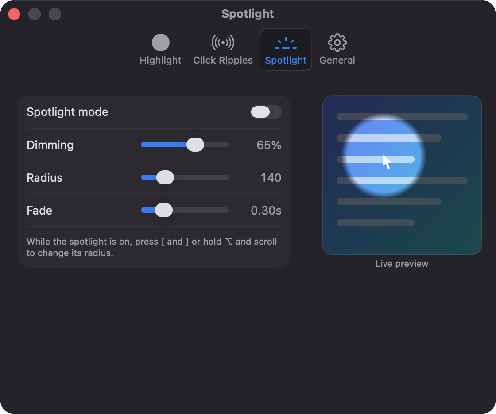
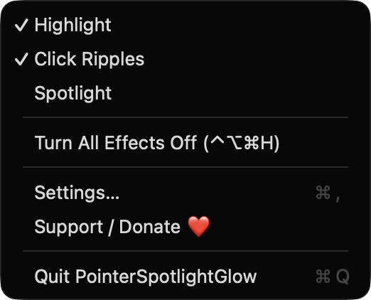
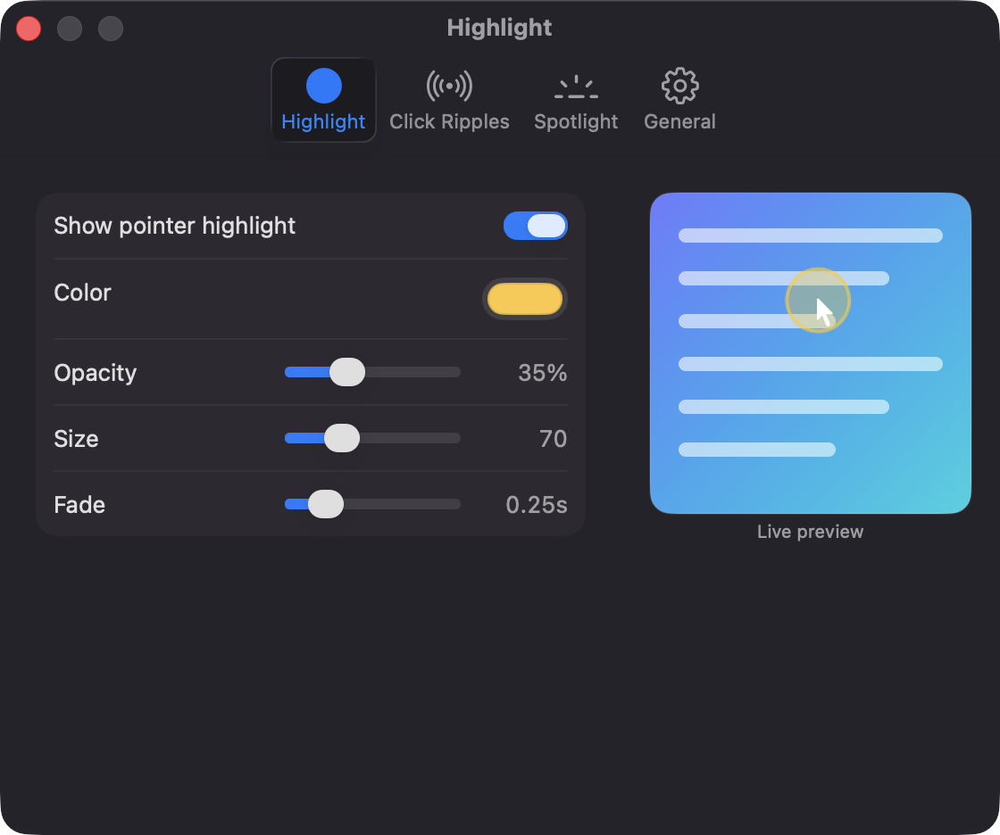
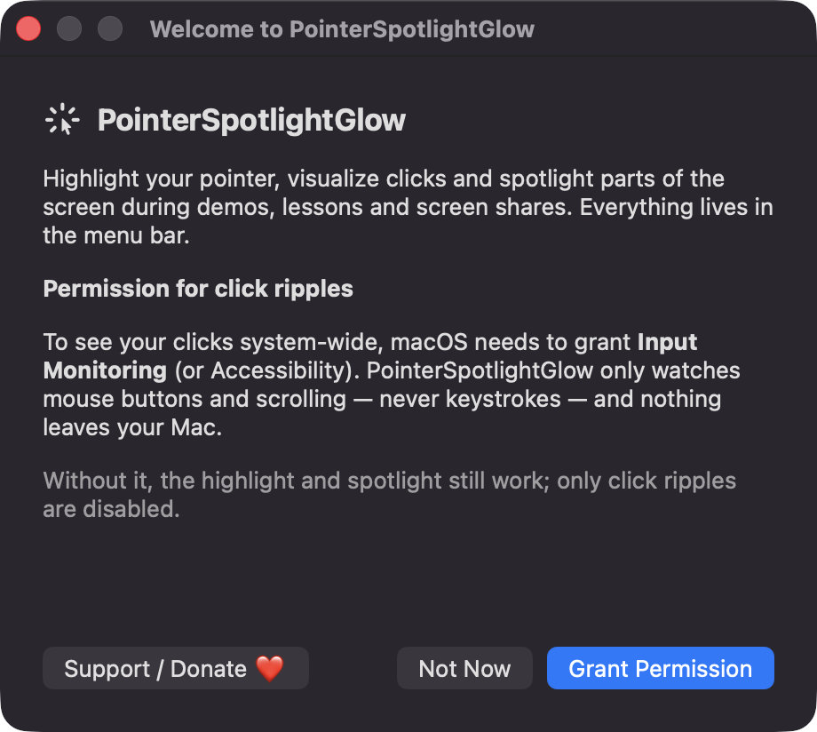

# PointerSpotlightGlow

**🌐 Website:** [turhe123.github.io/pointer-spotlight-glow](https://turhe123.github.io/pointer-spotlight-glow/)

Spotlight your pointer with a dimmed screen, highlight ring and click ripples for demos and screen shares.


## Why

Presenter cursor tools are a well-established category in *Presentation & Cursor* utilities, and paid apps such as Mouseposé ($9.99 one-time) were the inspiration here. PointerSpotlightGlow is a free, open-source, 100% native, backend-free alternative that covers the core effects: a highlighted pointer, click visualization and a screen spotlight.

## Features

- **Pointer highlight**: a soft colored circle that follows the cursor. Configurable color, opacity, size (20–200) and fade.
- **Click ripples**: an expanding ring on left click and a different color on right click, with a press indicator while the button is held. Configurable colors, opacity, size and duration.
- **Spotlight mode**: dims the whole screen and leaves a bright circle around the pointer. Configurable dimming, radius (40–500) and fade. Resize with `[` / `]` or ⌥ + scroll wheel.
- **Global hotkeys** (Carbon `RegisterEventHotKey`): ⌃⌥⌘H toggles all effects (and restores the previous set), ⌃⌥⌘S toggles the spotlight. Both can be re-recorded in Settings.
- **Menu bar app**: toggles for each effect, Settings, Support and Quit. The icon changes when all effects are off.
- **Settings window** with tabs for each effect, color wells, sliders and an animated live preview, plus a General tab.
- **Multi-display aware**: one transparent, click-through overlay per screen, rebuilt when the screen configuration changes.
- **Recording-friendly**: effects are visible in screen recordings and shares by default. An optional toggle hides them from capture.
- **Reduce Motion** support shortens animations.
- **Launch at login** via `SMAppService`.
- Preferences are saved locally in UserDefaults.

## Screenshots

<p align="center"></p>

<p align="center"><em>Spotlight settings with an animated live preview of the dimmed screen and the bright circle that follows the pointer.</em></p>

<p align="center"></p>

<p align="center"><em>The menu bar menu toggles Highlight, Click Ripples and Spotlight, and has a global shortcut to turn all effects off.</em></p>

<p align="center"></p>

<p align="center"><em>Pointer highlight settings for color, opacity, size and fade, with a live preview.</em></p>

<p align="center"></p>

<p align="center"><em>The first-launch welcome window explains the optional Input Monitoring permission that click ripples need.</em></p>

## Install

1. Download `PointerSpotlightGlow-macOS.zip` from the [latest release](https://github.com/turhe123/pointer-spotlight-glow/releases/latest).
2. Unzip it and move `PointerSpotlightGlow.app` to `/Applications`.
3. Because the app is open source and not notarized, run:

   ```bash
   xattr -cr /Applications/PointerSpotlightGlow.app
   ```

4. Right-click the app → **Open** the first time.

## Build from source

Requires macOS 14+ and Xcode with Swift 5.9+.

```bash
brew install xcodegen
xcodegen generate
xcodebuild -project PointerSpotlightGlow.xcodeproj -scheme PointerSpotlightGlow -configuration Release -derivedDataPath ./build build
```

The app is produced at `build/Build/Products/Release/PointerSpotlightGlow.app`.

## Permissions

- **Input Monitoring (or Accessibility)**: needed only for click ripples and ⌥ + scroll spotlight resizing. The app listens for mouse buttons and scrolling through global event monitors. It does not read keystrokes. Without this permission, the highlight and spotlight still work and Settings shows an explanatory note. A first-launch sheet explains this and offers to request access.
- **No other permissions**: the pointer position is polled at 60 Hz, which needs no permission. The app does not request Screen Recording or Microphone access, and it does not capture your screen. The overlays are ordinary windows that other tools can record.

## Built with AI

PointerSpotlightGlow was written by [Claude Code](https://claude.com/claude-code) inside an automated pipeline, from a plain-English spec. No code, binaries or assets from any commercial app were used; it is a clean-room reimplementation of a feature set, not a copy.

What that means in practice:

- The full source is in this repo under the MIT license. Read it before you run it.
- No network calls, no analytics, no third-party dependencies. Only Apple frameworks.
- Ad-hoc signed and not notarized, which is why Gatekeeper warns on first launch.
- It has had less human review than a hand-written app. Bug reports and pull requests are welcome.

## Support ❤️

If this saves you time, you can support development:

[Support Or (Leo) Davidai ❤️ on Ko-fi](https://ko-fi.com/leodavidai)

## License

MIT © Or Davidai Bachar

## More free Mac apps

Prefer something that runs in the browser? The same pipeline builds [free, private web tools](https://turhe123.github.io/web-tools/): PDF, image, developer, data and audio tools, nothing uploaded.
